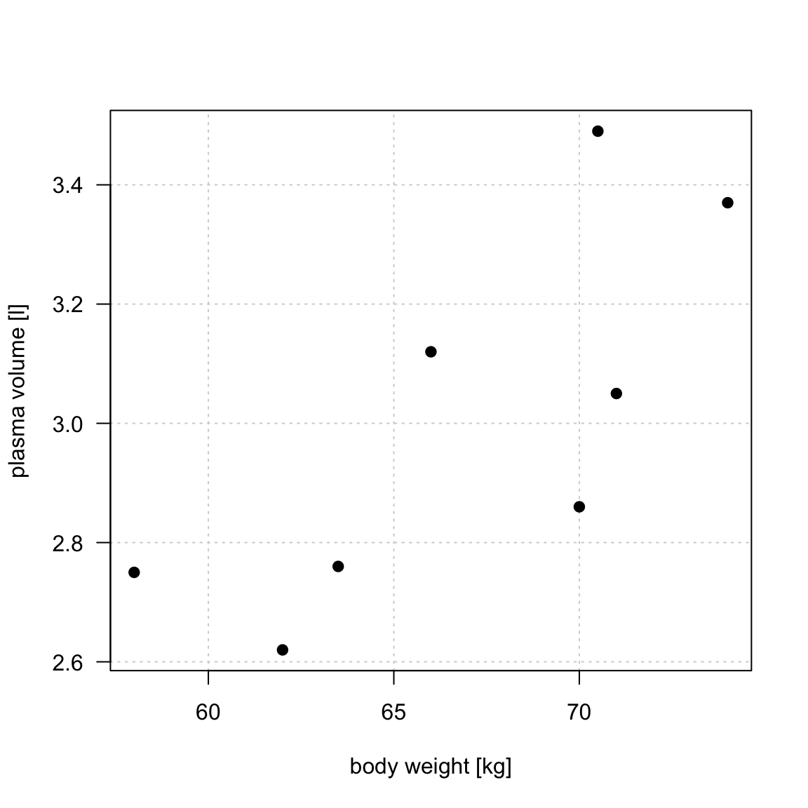
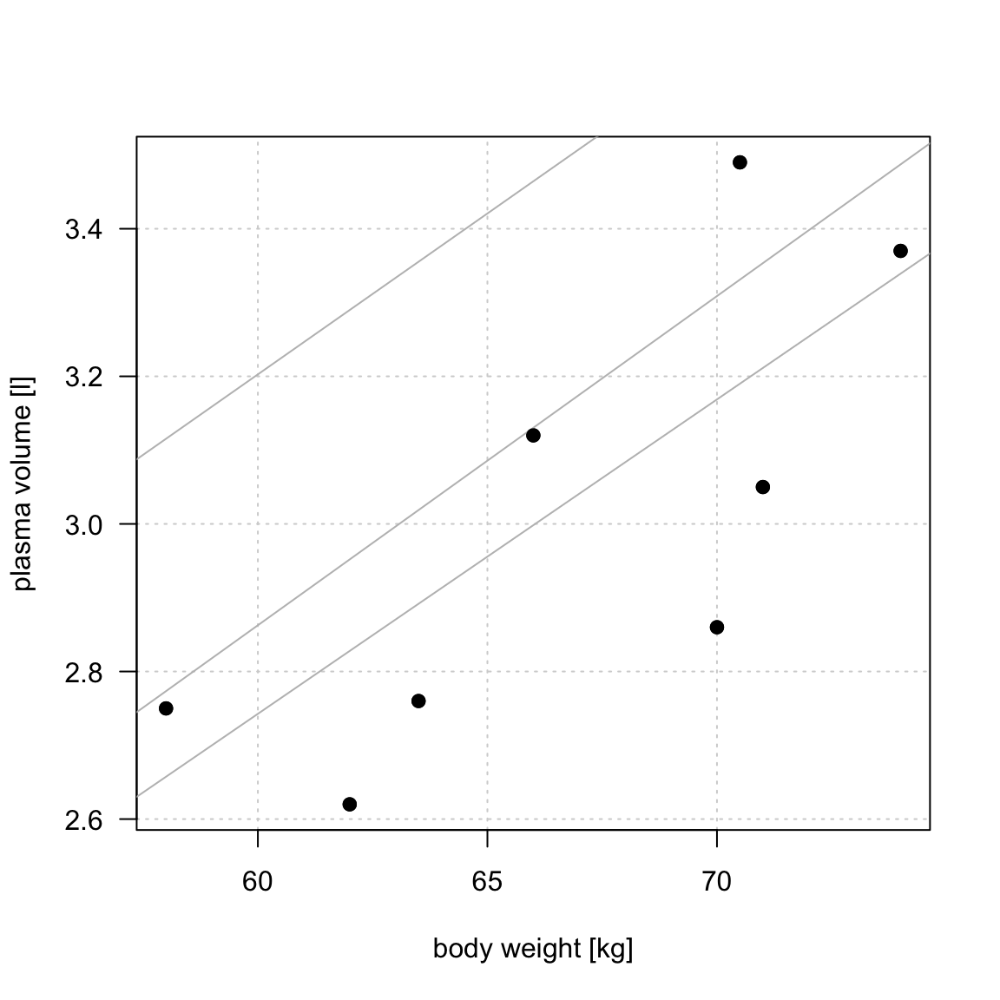
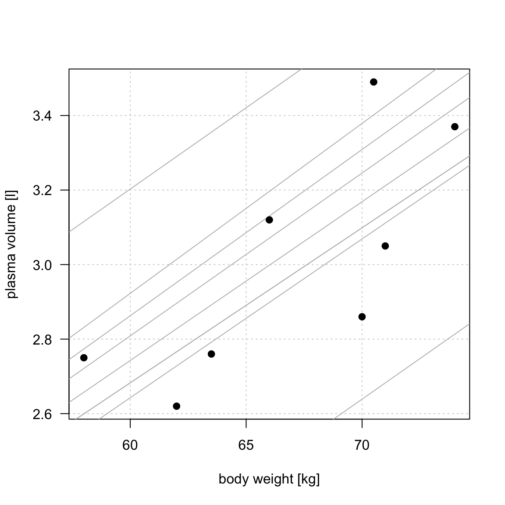
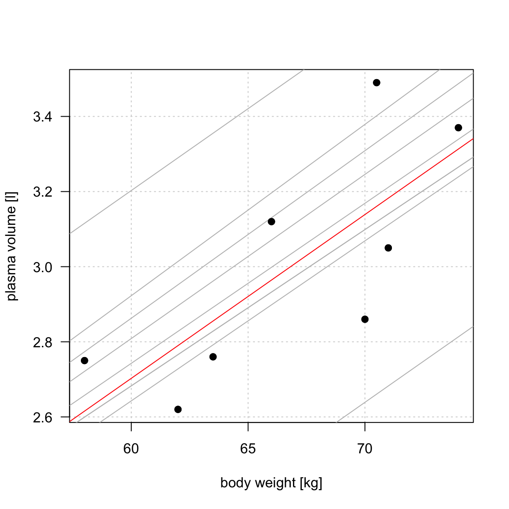

```{r}
#| message: false
#| warning: false
#| include: false

# load libraries
library(tidyverse)
library(magrittr)
library(faraway)
library(kableExtra)
library(ggplot2)
library(rmarkdown)
library(gridExtra)
library(ggiraphExtra)
library(latex2exp)

font.size <- 16
col.blue.light <- "#a6cee3"
col.blue.dark <- "#1f78b4"
my.ggtheme <- 
  theme_bw() + 
  theme(axis.title = element_text(size = font.size), 
        axis.text = element_text(size = font.size), 
        legend.text = element_text(size = font.size), 
        legend.title = element_blank(), 
        legend.position = "top") 
        


# add obesity and diabetes status to diabetes faraway data
inch2m <- 2.54/100
pound2kg <- 0.45
data_diabetes <- diabetes %>%
  mutate(height  = height * inch2m, height = round(height, 2)) %>% 
  mutate(waist = waist * inch2m) %>%  
  mutate(weight = weight * pound2kg, weight = round(weight, 2)) %>%
  mutate(BMI = weight / height^2, BMI = round(BMI, 2)) %>% 
  mutate(obese= cut(BMI, breaks = c(0, 29.9, 100), labels = c("No", "Yes"))) %>% 
  mutate(diabetic = ifelse(glyhb > 7, "Yes", "No"), diabetic = factor(diabetic, levels = c("No", "Yes"))) %>%
  na.omit()

```

## Outline
<br><br>

::: incremental

- Linear regression (recap)
- Generalized linear models
- Regularization
- Practical considerations

:::

## Why linear and regularized models?
<br>

::: columns
::: {.column width="50%"}

::: incremental

- **Simple and interpretable:** Show how predictors relate to outcomes.
- **Versatile:** Used for both regression and classification.
- **Strong baselines:** Often competitive with more complex models.
- **Useful in life sciences:** Regularization helps with high-dimensional data
- **Inference and prediction**
:::

:::

::: {.column width="5%"}
:::

::: {.column width="45%"}
```{r}
#| fig-width: 6
#| fig-height: 6
data_diabetes %>%
  ggplot(aes(x = height, y = weight)) + 
  geom_point() + 
  geom_smooth(method = "lm", se = FALSE) + 
  my.ggtheme + 
  xlab("height [m]") + 
  ylab("weight [kg]")
```
:::
:::


## What linear models are
*definition*
<br>

::: columns
::: {.column width="50%"}
::: incremental


- A linear model describes a **continuous outcome** $Y$ using one or more predictors $X$.

- For example, $$ Y_i = \beta_0 + \beta_1x_{1i} + \dots + \beta_px_{pi} + \epsilon_i $$

- where:
- $Y_i$ is the observed outcome for individual $i$
- $x_{1i},\dots,x_{pi}$ are predictor values
- $\beta_0,\dots,\beta_p$ are unknown model parameters describing how the expected outcome depends on the predictors (systematic part)
- $\epsilon_i$ represents variation not explained by the systematic part of the model
- Predictors can be **numerical, categorical, or a mixture of both.**
:::
:::

::: {.column width="5%"}
:::

::: {.column width="45%"}


```{r}
#| fig-width: 6
#| fig-height: 6
data_diabetes %>%
  ggplot(aes(x = height, y = weight)) + 
  geom_point() + 
  geom_smooth(method = "lm", se = FALSE) + 
  my.ggtheme + 
  xlab("height [m]") + 
  ylab("weight [kg]")
```
:::
:::


## What does "linear" mean?
<br>

:::: {.columns}

::: {.column width="45%"}
A linear model is **linear in its model parameters**.

For example:

$$
Y_i = \beta_0 + \beta_1X_i + \epsilon_i
$$

is a linear model.

<br>

But so is:

$$
Y_i = \beta_0 + \beta_1X_i + \beta_2X_i^2 + \epsilon_i
$$

because the parameters $\beta_0$, $\beta_1$ and $\beta_2$ still enter the model linearly.

:::

::: {.column width="5%"}

:::

::: {.column width="45%"}

```{r}
#| echo: false
#| fig-width: 7
#| fig-height: 8
#| warning: false

library(ggplot2)
library(patchwork)

set.seed(123)

# 1. Linear: Gene expression vs transcription factor concentration
x1 <- seq(0, 10, length.out = 60)
y1 <- 2 + 1.5 * x1 + rnorm(60, sd = 1.5)

df1 <- data.frame(x = x1, y = y1)

p1 <- ggplot(df1, aes(x, y)) +
  geom_point(color = "#4477AA", alpha = 0.55, size = 1.6) +
  geom_smooth(method = "lm", se = FALSE,
              color = "#CC6677", linewidth = 1.1) +
  labs(
    title = "Linear relationship",
    x = "Transcription factor concentration",
    y = "Gene expression"
  ) +
  theme_minimal(base_size = 12)

# 2. Quadratic: Enzyme activity vs temperature
x2 <- seq(15, 55, length.out = 60)
y2 <- 80 - 0.16 * (x2 - 37)^2 + rnorm(60, sd = 4)

df2 <- data.frame(x = x2, y = y2)

p2 <- ggplot(df2, aes(x, y)) +
  geom_point(color = "#4477AA", alpha = 0.55, size = 1.6) +
  geom_smooth(
    method = "lm",
    formula = y ~ poly(x, 2, raw = TRUE),
    se = FALSE,
    color = "#CC6677",
    linewidth = 1.1
  ) +
  labs(
    title = "Quadratic relationship",
    x = "Temperature (°C)",
    y = "Enzyme activity"
  ) +
  theme_minimal(base_size = 12)

p1 / p2
```

:::

::::

## Simple linear regression
<br>

. . .

Simple linear regression describes the relationship between **the numerical outcome and one numerical explanatory variable**

. . .

::: {#exm-simple-lm}

Weight and plasma volume

```{r}
#| code-fold: false
weight <- c(58, 70, 74, 63.5, 62.0, 70.5, 71.0, 66.0) # body weight (kg)
plasma <- c(2.75, 2.86, 3.37, 2.76, 2.62, 3.49, 3.05, 3.12) # plasma volume (liters)

```

``` r
weight <- c(58, 70, 74, 63.5, 62.0, 70.5, 71.0, 66.0) # body weight (kg)
plasma <- c(2.75, 2.86, 3.37, 2.76, 2.62, 3.49, 3.05, 3.12) # plasma volume (liters)
```
:::

```{r}
#| label: lm-intro-example
#| fig-align: center
#| echo: false
#| fig-width: 4
#| fig-height: 4
#| include: true

plot(weight, plasma, pch=19, las=1, xlab = "body weight [kg]", ylab="plasma volume [l]",  panel.first = grid())

```

::: footer
:::

## Simple linear regression

```{r}
#| label: fig-lm-01
#| include: false
#| fig-width: 6
#| fig-height: 6

plot(weight, plasma, pch=19, las=1, xlab = "body weight [kg]", ylab="plasma volume [l]",  panel.first = grid())

```

```{r}
#| label: fig-lm-02
#| include: false
#| fig-width: 6
#| fig-height: 6

plot(weight, plasma, pch=19, las=1, xlab = "body weight [kg]", ylab="plasma volume [l]", panel.first = grid())

reg1 <- lm(plasma ~ weight)
a <- reg1$coefficients[1]
b <- reg1$coefficients[2]

#abline(a=a+0.1 , b + 0.001, col="gray")
#abline(a=a+0.1 , b + 0.0001, col="gray")
#abline(a=a , b + 0.00015, col="gray")
#abline(a=a+0.1 , b + 0.002, col="gray")
# abline(a=a+0.1 , b - 0.002, col="gray")
# abline(a=a+0.1 , b - 0.002, col="gray")
# abline(a=a+0.1 , b - 0.001, col="gray")
# abline(a=a, b - 0.001, col="gray")
 abline(a=a+0.5 , b , col="gray")
# abline(a=a-0.5 , b , col="gray")

#abline(lm(plasma~weight), col="red") # regression line
points(weight, plasma, pch=19)

```

```{r}
#| label: fig-lm-03
#| include: false
#| fig-width: 6
#| fig-height: 6


plot(weight, plasma, pch=19, las=1, xlab = "body weight [kg]", ylab="plasma volume [l]", panel.first = grid())

reg1 <- lm(plasma ~ weight)
a <- reg1$coefficients[1]
b <- reg1$coefficients[2]

abline(a=a+0.1 , b + 0.001, col="gray")
#abline(a=a+0.1 , b + 0.0001, col="gray")
# abline(a=a , b + 0.00015, col="gray")
# abline(a=a+0.1 , b + 0.002, col="gray")
# abline(a=a+0.1 , b - 0.002, col="gray")
# abline(a=a+0.1 , b - 0.002, col="gray")
# abline(a=a+0.1 , b - 0.001, col="gray")
# abline(a=a, b - 0.001, col="gray")
abline(a=a+0.5 , b , col="gray")
# abline(a=a-0.5 , b , col="gray")

#abline(lm(plasma~weight), col="red") # regression line
points(weight, plasma, pch=19)

```

```{r}
#| label: fig-lm-03b
#| include: false
#| fig-width: 6
#| fig-height: 6


plot(weight, plasma, pch=19, las=1, xlab = "body weight [kg]", ylab="plasma volume [l]", panel.first = grid())

reg1 <- lm(plasma ~ weight)
a <- reg1$coefficients[1]
b <- reg1$coefficients[2]

abline(a=a+0.1 , b + 0.001, col="gray")
#abline(a=a+0.1 , b + 0.0001, col="gray")
# abline(a=a , b + 0.00015, col="gray")
#abline(a=a+0.1 , b + 0.002, col="gray")
# abline(a=a+0.1 , b - 0.002, col="gray")
# abline(a=a+0.1 , b - 0.002, col="gray")
 abline(a=a+0.1 , b - 0.001, col="gray")
#abline(a=a, b - 0.001, col="gray")
abline(a=a+0.5 , b , col="gray")
#abline(a=a-0.5 , b , col="gray")

#abline(lm(plasma~weight), col="red") # regression line
points(weight, plasma, pch=19)

```

```{r}
#| label: fig-lm-04
#| include: false
#| fig-width: 6
#| fig-height: 6


plot(weight, plasma, pch=19, las=1, xlab = "body weight [kg]", ylab="plasma volume [l]", panel.first = grid())

reg1 <- lm(plasma ~ weight)
a <- reg1$coefficients[1]
b <- reg1$coefficients[2]

abline(a=a+0.1 , b + 0.001, col="gray")
abline(a=a+0.1 , b + 0.0001, col="gray")
#abline(a=a , b + 0.00015, col="gray")
abline(a=a+0.1 , b + 0.002, col="gray")
abline(a=a+0.1 , b - 0.002, col="gray")
abline(a=a+0.1 , b - 0.002, col="gray")
abline(a=a+0.1 , b - 0.001, col="gray")
abline(a=a, b - 0.001, col="gray")
abline(a=a+0.5 , b , col="gray")
abline(a=a-0.5 , b , col="gray")

#abline(lm(plasma~weight), col="red") # regression line
points(weight, plasma, pch=19)

```

```{r}
#| label: fig-lm-05
#| include: false
#| fig-width: 6
#| fig-height: 6

plot(weight, plasma, pch=19, las=1, xlab = "body weight [kg]", ylab="plasma volume [l]", panel.first = grid())

reg1 <- lm(plasma ~ weight)
a <- reg1$coefficients[1]
b <- reg1$coefficients[2]

abline(a=a+0.1 , b + 0.001, col="gray")
abline(a=a+0.1 , b + 0.0001, col="gray")
#abline(a=a , b + 0.00015, col="gray")
abline(a=a+0.1 , b + 0.002, col="gray")
abline(a=a+0.1 , b - 0.002, col="gray")
abline(a=a+0.1 , b - 0.002, col="gray")
abline(a=a+0.1 , b - 0.001, col="gray")
abline(a=a, b - 0.001, col="gray")
abline(a=a+0.5 , b , col="gray")
abline(a=a-0.5 , b , col="gray")

abline(lm(plasma~weight), col="red") # regression line
points(weight, plasma, pch=19)
```

::: r-stack
{.fragment width="600" height="600"}

{.fragment width="600" height="600"}

{.fragment width="600" height="600"}

{.fragment width="600" height="600"}

{.fragment width="600" height="600"}

{.fragment width="600" height="600"}
:::


## Simple linear regression {.smaller}
<br>

In other words, we are finding the best-fitting straight line to **build a model** to represent the relationship between plasma volume ($Y$) and explanatory body weight variable ($x$)

. . .

<br>

:::: {.columns}
::: {.column width="55%"}

The model can be written as:

$$
Y_i = \alpha + \beta x_i + \epsilon_i,
$$

where:

- $x$: is **predictor**, **feature**,  exposure variable, explanatory variable, independent variable,covariate
- $Y$: is **response**, **outcome**, dependent variable
- $\alpha$: intercept (coefficient)
- $\beta$: regression coefficient
- $\epsilon_i$: random error term


The fitted model gives predicted values:


$$
\hat{y}_i=\hat{\alpha}+\hat{\beta}\cdot x_i
$$
In our case:

$$
\hat{y}_i=0.086+ 0.044 \cdot x_i
$$

:::


::: {.column width="5%"}
:::

::: {.column width="40%"}
```{r}
#| warning: false
#| message: false
#| echo: false
#| fig-height: 7

font.size <- 22
my.ggtheme <- theme_bw() + 
  theme(axis.title = element_text(size = font.size),
        axis.text = element_text(size = font.size),
        legend.text = element_text(size = font.size),
        legend.title = element_blank(),
        legend.position = "top") 
        
df <- data.frame(weight = weight, plasma = plasma)
df %>%
  ggplot(aes(x = weight, y = plasma)) + 
  geom_point(size = 3) + 
  geom_smooth(method = "lm", se = FALSE, color = "red", lwd = 3) + 
  xlab("body weight [kg]") +
  ylab("plasma volume [l]") + 
  my.ggtheme


```

:::
::::

::: footer
:::

::: notes
- $\epsilon_i$ represents variation of individual observations around the systematic relationship.
:::

## Least squares 
*estimating coefficients by minimizing RSS*
<br>

::: columns
::: {.column width="50%"}

Let

$$
\hat{y}_i=\hat{\alpha}+\hat{\beta}x_i
$$

be the fitted value for observation $i$.

- The **residual** is

$$
e_i = y_i-\hat{y}_i
$$

- The **residual sum of squares** is

$$
RSS = \sum_{i=1}^n e_i^2
$$

::: {.text-box-1}
- Least squares chooses $\hat{\alpha}$ and $\hat{\beta}$ to **minimize RSS**.
:::
:::

::: {.column width="10%"}
:::

::: {.column width="40%"}
```{r}
#| label: reg-errors
#| fig-align: center
#| fig-cap-location: margin
#| echo: false
#| warning: false
#| message: false
#| fig-width: 8
#| fig-height: 8

data.reg <- data.frame(plasma=plasma, weight=weight)
fit.reg <- lm(plasma~weight, data=data.reg)
data.reg$predicted <- predict(fit.reg)
data.reg$residuals <- residuals((fit.reg))

ggplot(data.reg, aes(x=weight, plasma)) + 
  geom_point() +
  geom_smooth(method = "lm", se = FALSE, color = "firebrick") +
  geom_segment(aes(xend = weight, yend = predicted), color="blue") +
  geom_point(aes(y = predicted), shape = 1) +
  geom_point(aes(y = predicted), shape = 1) +
  xlab("body weight [kg]") + ylab("plasma volume [liters]") + 
  my.ggtheme

```
:::
:::

## Another way to view the linear model
*Expected-value interpretation*

<br>

Another way to think about a linear regression model is that it describes the expected value of the outcome for a given value of the predictor.

$$
E(Y \mid X=x)=\alpha+\beta x
$$

. . .

<br>

Individuals with the same value of the predictor can have different outcomes. The regression line describes their expected, or average, outcome.

<br>


## Slope

$\widehat{plasma} = 0.0857 + 0.0436 \cdot weight$

Linear regression estimates the model parameters $\alpha$ and $\beta$:
$Y_i = \alpha + \beta x_i + \epsilon_i$

The slope $\hat{\beta}=0.0436$ describes the expected change in plasma volume
for a one-unit increase in body weight.

```{r}
#| fig-align: center

model <- lm(plasma ~ weight)
alpha <- model$coefficients[1]
beta <- model$coefficients[2]

my.s <- 2
par(mfcol=c(1,2))

# Beta 1 example a
plot(weight, plasma, pch=19, las=1, xlab = "body weight [kg]", ylab="plasma volume [l]",  panel.first = grid())
abline(lm(plasma~weight), col="red") # regression line
abline(h = alpha + beta * 65, col = "blue",  lty = 3)
abline(h = alpha + beta * 70, col = "blue",  lty = 3)
segments(x0=65, y0=alpha + beta * 65, x1=70, y1=alpha + beta * 65, col="blue")
segments(x0=70, y0=alpha + beta * 65, x1=70, y1=alpha + beta * 70, col="blue")
text(72, 2.95, expression(beta), cex=1.2, col="blue")
text(60, alpha + beta * 65 + 0.05, round(alpha + beta * 65, 2), cex=1.2, col="blue")
text(60, alpha + beta * 70 + 0.05, round(alpha + beta * 70, 2), cex=1.2, col="blue")

# Beta 1 example b
plot(weight, plasma, pch=19, las=1, xlab = "body weight [kg]", ylab="plasma volume [l]",  panel.first = grid(), xlim=c(60, 70), ylim=c(2.8, 3.2))
abline(lm(plasma~weight), col="red") # regression line
abline(h = alpha + beta * 65, col = "blue",  lty = 3)
abline(h = alpha + beta * 66, col = "blue",  lty = 3)
segments(x0=65, y0=alpha + beta * 65, x1=66, y1=alpha + beta * 65, col="blue")
segments(x0=66, y0=alpha + beta * 65, x1=66, y1=alpha + beta * 66, col="blue")
text(67, 2.94, expression(beta), cex=1.2, col="blue")
text(61, alpha + beta * 65 - 0.02, round(alpha + beta * 65, 2), cex=1.2, col="blue")
text(61, alpha + beta * 66 + 0.02, round(alpha + beta * 66, 2), cex=1.2, col="blue")

```

Increasing weight by 5 kg corresponds to $3.14 - 2.92 = 0.22$ increase in plasma volume. Increasing weight by 1 kg corresponds $2.96 - 2.92 = 0.04$ increase in plasma volume

::: footer
:::

## Intercept

$\widehat{plasma} = 0.0857 + 0.0436 \cdot weight$

Linear regression estimates the model parameters $\alpha$ and $\beta$:
$Y_i = \alpha + \beta x_i + \epsilon_i$

```{r}
#| fig-align: center

# Values from regression model: plasma_volume = 0.0857 + 0.043615*x
par(mfcol=c(1,2))

# Fitted line
plot(weight, plasma, cex.main = my.s, cex.main=my.s, pch=19, las=1, xlab = "body weight [kg]", ylab="plasma volume [l]",  panel.first = grid())
abline(lm(plasma~weight), col="red") # regression line
text(65, 3.3, "plasma = 0.0857 + 0.0436 * weight", cex=1)

# Beta 0 example a
plot(weight, plasma, pch=19, las=1, xlab = "body weight [kg]", ylab="plasma volume [l]",  panel.first = grid(), xlim=c(-20, 80), ylim=c(0, 5))
abline(lm(plasma~weight), col="red") # regression line
abline(h=alpha, col="blue", lty = 3) # regression line
segments(x0=65, y0=2.92, x1=66, y1=2.92, col="blue")
segments(x0=66, y0=2.92, x1=66, y1=2.964, col="blue")
text(15, 0.4, expression(alpha), cex=1.2, col="blue")
text(33, 0.5, paste("= ", round(alpha,3), sep=""), cex=1.2, col="blue")

```

The intercept $\hat{\alpha}=0.0857$ is the expected outcome when the predictor equals zero. It is not always meaningful.

::: footer
:::

## Inference  {.smaller}
*Hypothesis testing in linear regression*
<br>

We can test whether a predictor is associated with the outcome.

**Hypotheses:**

- $H_0: \beta = 0$ — no linear association between $X$ and $Y$
- $H_a: \beta \neq 0$ — a non-zero linear association

. . .

**Test statistic:**

$$
t = \frac{\hat{\beta}}{SE(\hat{\beta})}
$$

- Compares the estimated coefficient to its **standard error**.
- Under $H_0$, follows a **t-distribution** with $n-p$ degrees of freedom.
- A larger absolute $t$-value provides stronger evidence against $H_0$.

. . .

**The p-value** measures how unusual a result this extreme (or more extreme) would be if $H_0$ were true.

. . .

<br>

::: {.key-message-box}
**Statistical significance does not necessarily imply biological importance or predictive usefulness.**
:::

## Predictions
<br>

$$
\hat{y}_i=0.086+ 0.044 \cdot x_i
$$


:::: {.columns}

::: {.column width="45%"}

```{r}
#| include: true
#| code-fold: show
#| echo: true

# model plasma using weight
data_plasma <- data.frame(plasma = plasma, weight = weight)
model <- lm(plasma ~ weight, data = data_plasma)


# use model for predictions
data_new <- data.frame(weight = 60)
predict(model, newdata = data_new)

```

:::

::: {.column width="5%"}
:::

::: {.column width="45%"}

```{r}
#| warning: false
#| message: false
#| echo: false
#| fig-height: 7

font.size <- 22
my.ggtheme <- theme_bw() + 
  theme(axis.title = element_text(size = font.size),
        axis.text = element_text(size = font.size),
        legend.text = element_text(size = font.size),
        legend.title = element_blank(),
        legend.position = "top") 
        
df <- data.frame(weight = weight, plasma = plasma)
df %>%
  ggplot(aes(x = weight, y = plasma)) + 
  geom_point(size = 3) + 
  geom_smooth(method = "lm", se = FALSE, color = "red", lwd = 3) + 
  xlab("body weight [kg]") +
  ylab("plasma volume [l]") + 
  my.ggtheme


```

:::
::::


## R^2 and R^2(adj)
*measuring the model fit*
<br>

::: columns
::: {.column width="40%"}
```{r}
#| fig-width: 8
#| fig-height: 12

par(mfrow=c(2,1))

# TSS
plot(weight, plasma, pch=19, xlab="Weight [kg]", ylab="Plasma volume [l]", main = "TSS", cex.main = 0.8)
abline(h=mean(plasma), col="purple")

for (i in 1:length(weight)){
  segments(weight[i], plasma[i], weight[i], mean(plasma))
}

# RSS
plot(weight, plasma, pch=19, xlab="Weight [kg]", ylab="Plasma volume [l]", main = "RSS", cex.main = 0.8)
abline(lm(plasma ~ weight), col="red")
model <- lm(plasma ~ weight)

for (i in 1:length(weight)){
  segments(weight[i], plasma[i], weight[i], model$fitted.values[i])
}

```
:::

::: {.column width="60%"}
<br>


Measure of model fit is given by $$R^2 = 1 - \frac{RSS}{TSS}$$ where:

-   RSS is the residual sum-of-squares the fitted model of interest
-   TSS is the sum of squares of the **null model**

<br>

-   In the case of multiple linear regression we are using the **adjusted version of** $R^2$ to account for multiple predictors:
$$R^2(adj) = 1 - (1-R^2)\frac{n-1}{n-p-1}$$
:::
:::


## Multiple regression
<br>

```{r}
#| echo: false
#| fig-width: 7
#| fig-height: 4.5

library(ggplot2)

set.seed(123)

n <- 150
df <- data.frame(
  Age = runif(n, 20, 75),
  Sex = factor(sample(c("Female", "Male"), n, replace = TRUE))
)

df$BMI <- 21 + 0.12 * df$Age +
  1.8 * (df$Sex == "Male") +
  rnorm(n, sd = 2.5)

fit <- lm(BMI ~ Age + Sex, data = df)

# Predictions from the additive model
newdata <- expand.grid(
  Age = seq(20, 75, length.out = 100),
  Sex = levels(df$Sex)
)
newdata$BMI <- predict(fit, newdata)

ggplot(df, aes(Age, BMI, color = Sex)) +
  geom_point(alpha = 0.5, size = 2) +
  geom_line(
    data = newdata,
    aes(y = BMI),
    linewidth = 1.2
  ) +
  labs(
    title = "Multiple regression: Age + Sex",
    x = "Age (years)",
    y = "BMI (kg/m²)"
  ) +
  theme_minimal(base_size = 15)

```

## Multiple regression
<br>

```{r}

#| echo: false
#| warning: false

library(plotly)

set.seed(123)

n <- 120

df <- data.frame(
  Age = runif(n, 20, 80),
  BMI = runif(n, 18, 38)
)

df$SBP <- 75 + 0.6 * df$Age +
  1.2 * df$BMI +
  rnorm(n, sd = 8)

fit <- lm(SBP ~ Age + BMI, data = df)

age_grid <- seq(20, 80, length.out = 30)
bmi_grid <- seq(18, 38, length.out = 30)

# Predicted values on the regression plane
grid <- expand.grid(Age = age_grid, BMI = bmi_grid)

z <- matrix(
  predict(fit, newdata = grid),
  nrow = length(age_grid),
  ncol = length(bmi_grid)
)

plot_ly() %>%
  add_markers(
    data = df,
    x = ~Age, y = ~BMI, z = ~SBP,
    marker = list(size = 3, color = "#4477AA",
                  opacity = 0.65),
    name = "Observations"
  ) %>%
  add_surface(
    x = age_grid,
    y = bmi_grid,
    z = t(z),
    opacity = 0.55,
    showscale = FALSE,
    name = "Regression plane"
  ) %>%
  layout(
    title = "Multiple regression: Age + BMI",
    scene = list(
      xaxis = list(title = "Age (years)"),
      yaxis = list(title = "BMI (kg/m²)"),
      zaxis = list(title = "Systolic BP (mmHg)")
    )
  )

```


## Assumptions of linear regression
<br>

Ordinary linear regression relies on several assumptions:

- **Linearity:** The expected outcome is a linear combination of the predictors.
- **Independence:** Errors are independent across observations.
- **Constant variance (homoscedasticity):** Errors have similar variance across fitted values.
- **Normality:** Errors are normally distributed (important for classical small-sample inference).
- **No perfect multicollinearity:** Predictors are not exact linear combinations of one another.


# Generalized Linear Models (GLMs)


## Linear models describe expected outcomes
<br>

In the linear model, we describe the expected value of the outcome:

$$
E(Y_i \mid \mathbf{x}_i)
=
\beta_0+\beta_1x_{1i}+\cdots+\beta_px_{pi}
$$

This works well for many continuous outcomes.

. . .

<br>

But not all outcomes are continuous.

## When the outcome is not continuous
<br>

Examples:

- binary: disease yes/no, response yes/no
- counts: number of events, number of cases
- proportions: successes out of trials

. . .

<br>

For these outcomes, the expected value has restrictions:

::: incremental

- probabilities must be between 0 and 1
- expected counts must be positive

:::

## Restrictions
*Example*

<br>

-   Fitting a regression line to binary data yields predicted values that could take any value, including $<0$,


```{r}
#| label: log-example
#| message: false
#| warning: false
#| fig-cap: "Example of fitting linear model to binary data, to model obesity status coded as 1 (Yes) and 0 (No) with waist variable. Linear model does not fit the data well in this case and the predicted values can take any value, not only 0 and 1."
#| fig-cap-location: bottom
#| fig-height: 10

font.size <- 24
col.blue.light <- "#a6cee3"
col.blue.dark <- "#1f78b4"
my.ggtheme <- theme_bw() + 
  theme(axis.title = element_text(size = font.size),
        axis.text = element_text(size = font.size),
        legend.text = element_text(size = font.size),
        legend.title = element_blank(),
        legend.position = "top") 
        

data_diabetes %>%
  mutate(obese = as.numeric(obese) - 1) %>%
  ggplot(aes(y=obese, x=waist)) +
  geom_jitter(width=0, height = 0.1, size = 3, alpha = 0.8) +
  geom_smooth(method="lm", se=FALSE, color=col.blue.dark) + 
  my.ggtheme

```

```{r}
#| message: false
#| warning: false
#| include: false

# load libraries
library(tidyverse)
library(magrittr)
library(faraway)
library(kableExtra)
library(ggplot2)
library(rmarkdown)
library(gridExtra)
library(ggiraphExtra)
library(latex2exp)

font.size <- 16
col.blue.light <- "#a6cee3"
col.blue.dark <- "#1f78b4"
my.ggtheme <- 
  theme_bw() + 
  theme(axis.title = element_text(size = font.size), 
        axis.text = element_text(size = font.size), 
        legend.text = element_text(size = font.size), 
        legend.title = element_blank(), 
        legend.position = "top") 
        
# input data
input_diabetes <- read_csv("data/data-diabetes.csv")

# clean data
inch2cm <- 2.54
pound2kg <- 0.45
data_diabetes <- input_diabetes %>%
  mutate(height  = height * inch2cm / 100, height = round(height, 2)) %>% 
  mutate(waist = waist * inch2cm) %>% 
  mutate(weight = weight * pound2kg, weight = round(weight, 2)) %>%
  mutate(BMI = weight / height^2, BMI = round(BMI, 2)) %>%
  mutate(BMI_gt30= cut(BMI, breaks = c(0, 29.9, 100), labels = c(0, 1))) %>%
  mutate(location = factor(location)) %>%
  mutate(frame = factor(frame)) %>%
  mutate(gender = factor(gender))

```


## The GLM idea

We keep the same **linear predictor**:

$$
\eta_i =
\beta_0+\beta_1x_{1i}+\cdots+\beta_px_{pi}.
$$

But instead of modelling the expected outcome directly, we connect it to
the linear predictor through a **link function**:

$$
g(\mu_i)=\eta_i,
$$

where

$$
\mu_i=E(Y_i\mid\mathbf{x}_i).
$$

## Link functions {.center}

<br>

| Outcome              | Model               | Distribution | Link     |
| -------------------- | ------------------- | ------------ | -------- |
| Continuous           | Linear regression   | Normal       | identity |
| Binary / proportions | Logistic regression | Binomial     | logit    |
| Counts               | Poisson regression  | Poisson      | log      |
| Positive continuous  | Gamma regression    | Gamma        | log      |


# Logistic regression

## Logistic regression {.smaller}

<br>

::: columns
::: {.column width="50%"}
- Since the response variable takes only two values (Yes/No), we use a
  **logistic regression** model to model the **probability of having BMI over 30
  (Yes)**.

- Let

  $$
  p_i = P(Y_i = 1)
  $$

  denote the probability that individual $i$ has BMI > 30

- For a binary response, we assume

  $$
  Y_i \sim \operatorname{Binomial}(1,p_i),
  $$

  which is equivalent to a Bernoulli distribution.

- Logistic regression uses the **logit link** to relate this probability to
  the linear predictor:

  $$
  \log\left(\frac{p_i}{1-p_i}\right)
  =
  \beta_0+\beta_1x_i.
  $$

- Equivalently, the probability can be written as

  $$
  p_i =
  \frac{\exp(\beta_0+\beta_1x_i)}
  {1+\exp(\beta_0+\beta_1x_i)}.
  $$

  This ensures that the fitted probabilities always lie between 0 and 1.
:::

::: {.column width="5%"}
:::

::: {.column width="45%"}
```{r}
#| fig-height: 8

p1 <- data_diabetes %>%
  mutate(BMI_gt30 = as.numeric(BMI_gt30)) %>% 
  ggplot(aes(y=BMI_gt30, x=waist)) +
  geom_jitter(width=0, height = 0.05, alpha = 0.7, size = 3) +
  my.ggtheme

p2 <- data_diabetes %>%
  ggplot(aes(x = BMI_gt30, y = waist, fill = BMI_gt30)) + 
  geom_boxplot() + 
  scale_fill_brewer(palette = "Set2") + 
  my.ggtheme

p1
```

:::
:::


## Logistic regression
*R* 
<br>

In R we can use `glm()` function to fit GLM models:

``` r
# fit logistic regression model
logmodel_1 <- glm(obese ~ waist, family = binomial(link="logit"), data = data_diabetes)

# print model summary
print(summary(logmodel_1))
```

```{r}
#| code-fold: false
#| collapse: true
#| message: false
#| warning: false
#| fig-cap: "Fitted logistic model to diabetes data given the 130 study participants and using waist as explantatory variable to model obesity status."

# re-code obese status from Yes/No to 1/0
data_diabetes <- 
  data_diabetes %>%
  mutate(BMI_gt30 = as.numeric(BMI_gt30)-1)

# fit logistic regression model
logmodel_1 <- glm(BMI_gt30 ~ waist, family = binomial(link="logit"), data = data_diabetes)

# print model summary
print(summary(logmodel_1))

```


. . .

## Logistic regression

*R* <br>

```{r}
#| code-fold: false
#| collapse: true
#| message: false
#| warning: false
#| fig-cap: "Fitted logistic model to diabetes data given the 130 study participants and using waist as explantatory variable to model obesity status."
#| fig-width: 10
#| fig-height: 6
#| fig-align: center


font.size <- 14
col.blue.light <- "#a6cee3"
col.blue.dark <- "#1f78b4"
my.ggtheme <- theme(axis.title = element_text(size = font.size), 
        axis.text = element_text(size = font.size), 
        legend.text = element_text(size = font.size), 
        legend.title = element_blank(), 
        legend.position = "top") + 
        theme_bw()

# plot
ggPredict(logmodel_1) + 
  my.ggtheme

```

## Logistic regression
*Inference & Predictions* 
<br>

::: columns
::: {.column width="40%"}
- As in linear regression, we can test whether a predictor is associated with the outcome by testing

  $$
  H_0:\beta_j=0.
  $$

:::

::: {.column width="5%"}
:::

::: {.column width="55%"}

``` r
# fit logistic regression model
logmodel_1 <- glm(BMI_gt30~ waist, family = binomial(link="logit"), data = data_diabetes)
summary(logmodel_1)
```

```{r}
summary(logmodel_1)
```
:::
:::


## Logistic regression
*Deviance (rather than $R^2$)* 
<br>
<br>

- **Deviance** measures how well a model fits the observed data relative to a
  perfectly fitting (saturated) model. Smaller deviance indicates better fit.

- Deviance can also be used to compare **nested models**, for example to test
  whether adding an explanatory variable improves the model.

- In a **likelihood ratio test**, the test statistic is the difference in
  deviance between the reduced and full models:

  $$
  \Delta D = D_{\text{reduced}} - D_{\text{full}}.
  $$

  Under the null hypothesis,

  $$
  \Delta D \approx \chi^2_{df},
  $$

  where $df$ is the difference in the number of estimated parameters between
  the two models.


## Logistic regression
*Odds ratio* 
<br>

::: columns
::: {.column width="40%"}

- In logistic regression, we often interpret coefficients by exponentiating them:

  $$
  OR = e^{\hat{\beta}}.
  $$

- This gives an **odds ratio**.

- For example, if $\hat{\beta}=0.18$,

  $$
  e^{0.18}\approx1.2.
  $$

  This means that for each one-unit increase in `waist`, the odds of obesity are multiplied by about 1.2.

:::

::: {.column width="5%"}
:::

::: {.column width="55%"}
``` r
# fit logistic regression model
logmodel_1 <- glm(BMI_gt30~ waist, family = binomial(link="logit"), data = data_diabetes)

# print model summary
print(summary(logmodel_1))
```

```{r}
summary(logmodel_1)
```
:::
:::


# Regularization

## Regularized linear models
*definition* <br><br>

::: incremental
-   Regularized regression expands on the regression by adding a **penalty term(s)** to **shrink the model coefficients** of less important features towards zero.
-   This can help to prevent overfitting and improve the accuracy of the predictive model.
-   Depending on the penalty added, we talk about **Ridge**, **Lasso** or **Elastic Nets regression**.
:::

## Regularized regression

*Ridge regression* <br>

-   Previously we saw that the least squares fitting procedure estimates model coefficients $\beta_0, \beta_1, \cdots, \beta_p$ using the values that minimize the residual sum of squares: $$RSS = \sum_{i=1}^{n} \left( y_i - \beta_0 - \sum_{j=1}^{p}\beta_jx_{ij} \right)^2$$

. . .

-   In **regularized regression** the coefficients are estimated by minimizing slightly different quantity. Specifically, in **Ridge regression** we estimate $\hat\beta^{L}$ that minimizes $$\sum_{i=1}^{n} \left( y_i - \beta_0 - \sum_{j=1}^{p}\beta_jx_{ij} \right)^2 + \lambda \sum_{j=1}^{p}\beta_j^2 = RSS + \lambda \sum_{j=1}^{p}\beta_j^2$$ {#eq-ridge}

where:

$\lambda \ge 0$ is a **tuning parameter** to be determined separately e.g. via cross-validation

## Regularized regression
*Ridge regression* <br> <br>

$$\sum_{i=1}^{n} \left( y_i - \beta_0 - \sum_{j=1}^{p}\beta_jx_{ij} \right)^2 + \lambda \sum_{j=1}^{p}\beta_j^2 = RSS + \lambda \sum_{j=1}^{p}\beta_j^2$$

<br><br>

@eq-ridge trades two different criteria:

-   lasso regression seeks coefficient estimates that fit the data well, by making RSS small
-   however, the second term $\lambda \sum_{j=1}^{p}\beta_j^2$, called **shrinkage penalty** is small when $\beta_1, \cdots, \beta_p$ are close to zero, so it has the effect of **shrinking** the estimates of $\beta_j$ towards zero.
-   the tuning parameter $\lambda$ controls the relative impact of these two terms on the regression coefficient estimates
    -   when $\lambda = 0$, the penalty term has no effect
    -   as $\lambda \rightarrow \infty$ the impact of the shrinkage penalty grows and the ridge regression coefficient estimates approach zero

## Regularized regression

*Ridge regression* <br>

```{r}
#| label: ridge-input-data
#| eval: true
#| echo: false
#| warning: false
#| message: false

library(tidyverse)
library(kableExtra)

# # define scale function
# scale_numeric <- function(x, na.rm = TRUE){
#   (x - mean(x, na.rm = na.rm)) / sd(x, na.rm)
#   }

# input data
input_diabetes <- read_csv("data/data-diabetes.csv")

# clean data
inch2cm <- 2.54
pound2kg <- 0.45
data_diabetes <- input_diabetes %>%
  mutate(height  = height * inch2cm / 100, height = round(height, 2)) %>% 
  mutate(waist = waist * inch2cm) %>% 
  mutate(weight = weight * pound2kg, weight = round(weight, 2)) %>%
  mutate(BMI = weight / height^2, BMI = round(BMI, 2)) %>%
  mutate(obese= cut(BMI, breaks = c(0, 29.9, 100), labels = c("No", "Yes"))) %>%
  mutate(diabetic = ifelse(glyhb > 7, "Yes", "No"), diabetic = factor(diabetic, levels = c("No", "Yes"))) %>%
  mutate(location = factor(location)) %>%
  mutate(frame = factor(frame)) %>%
  mutate(gender = factor(gender))

```

```{r}
#| label: ridge-run
#| warning: false
#| message: false
#| fig-cap: "Example of Ridge regression to model BMI using age, chol, hdl and glucose variables: model coefficients are plotted over a range of lambda values, showing how initially for small lambda values all variables are part of the model and how they gradually shrink towards zero for larger lambda values."
#| fig-cap-location: margin

library(glmnet)
library(latex2exp)

# select subset data
# and scale: since regression puts constraints on the size of the coefficient
data_input <- data_diabetes %>%
  dplyr::select(BMI, chol, hdl, age, stab.glu) %>% 
  na.omit() 
  
# fit ridge regression for a series of lambda values 
# note: lambda values were chosen by experimenting to show lambda effect on beta coefficient estimates
x <- model.matrix(BMI ~., data = data_input)
y <- data_input %>% pull(BMI)
model <- glmnet(x, y, alpha=0, lambda = seq(0, 100, 1))

# plot beta estimates vs. lambda
betas <- model$beta %>% as.matrix() %>% t()
data_plot <- tibble(data.frame(lambda = model$lambda, betas)) %>%
  dplyr::select(-"X.Intercept.") %>%
  pivot_longer(-lambda, names_to = "variable", values_to = "beta")

data_plot %>%
  ggplot(aes(x = lambda, y = beta, color = variable)) +
  geom_line(linewidth = 2, alpha = 0.7) + 
  theme_classic() +
  xlab(TeX("$\\lambda$")) + 
  ylab(TeX("Standardized coefficients")) + 
  scale_color_brewer(palette = "Set1") + 
  theme(legend.title = element_blank(), legend.position = "top", legend.text = element_text(size=12)) + 
  theme(axis.title = element_text(size = 12), axis.text = element_text(size = 10))

```

## Bias-variance trade-off
<br><br>

:::: {.columns}

::: {.column width="45%"}
Ridge regression can improve prediction by accepting a little more **bias** in exchange for lower **variance**.

::: {.incremental}
- **Bias**: error from a model that is too simple  
  → may miss real patterns  
  → **underfitting**

- **Variance**: error from a model that is too sensitive to the training data  
  → may capture noise  
  → **overfitting**

- Regularization reduces flexibility by shrinking coefficients  
  → often lower variance  
  → better prediction on new data
:::

$$
\text{prediction error} \approx \text{bias}^2 + \text{variance} + \text{irreducible error}
$$
:::

::: {.column width="5%"}
:::

::: {.column width="45%"}

```{r}
#| label: fig-bias-variance-new
#| fig-cap: "Bias-variance trade-off. Increasing model flexibility decreases bias but increases variance. Prediction error is minimized at an intermediate level of complexity."
#| fig-width: 8
#| fig-height: 5.5
#| echo: false

library(ggplot2)

x <- seq(0, 1, length.out = 200)

# Illustrative curves
bias2 <- 1.1 * exp(-3 * x) + 0.08
variance <- 0.08 + 0.75 * x^2
irreducible <- 0.12

test_error <- bias2 + variance + irreducible

df <- data.frame(
  flexibility = rep(x, 3),
  error = c(bias2, variance, test_error),
  component = factor(
    rep(c("Bias²", "Variance", "Test error"), each = length(x)),
    levels = c("Bias²", "Variance", "Test error")
  )
)

ggplot(df, aes(
  x = flexibility,
  y = error,
  linetype = component
)) +
  geom_line(linewidth = 1.4) +
  labs(
    x = "Model flexibility",
    y = "Error",
    linetype = NULL
  ) +
  scale_x_continuous(
    breaks = c(0, 1),
    labels = c("Low", "High")
  ) +
  theme_classic(base_size = 17) +
  theme(
    legend.position = "top"
  )
```


:::


::::

## Ridge vs. Lasso

In **Ridge** regression we minimize: $$\sum_{i=1}^{n} \left( y_i - \beta_0 - \sum_{j=1}^{p}\beta_jx_{ij} \right)^2 + \lambda \sum_{j=1}^{p}\beta_j^2 = RSS + \lambda \sum_{j=1}^{p}\beta_j^2$$ {#eq-ridge2} where $\lambda \sum_{j=1}^{p}\beta_j^2$ is also known as **L2** regularization element or $l_2$ penalty


<br>
<br>

In **Lasso** regression, that is Least Absolute Shrinkage and Selection Operator regression we change penalty term to absolute value of the regression coefficients: $$\sum_{i=1}^{n} \left( y_i - \beta_0 - \sum_{j=1}^{p}\beta_jx_{ij} \right)^2 + \lambda \sum_{j=1}^{p}|\beta_j| = RSS + \lambda \sum_{j=1}^{p}|\beta_j|$$ {#eq-lasso} where $\lambda \sum_{j=1}^{p}|\beta_j|$ is also known as **L1** regularization element or $l_1$ penalty

<br>


## Ridge vs. Lasso

::: columns
::: {.column width="50%"}
```{r}
#| label: ridge-input-data-02
#| eval: true
#| echo: false
#| warning: false
#| message: false

library(tidyverse)
library(kableExtra)

# # define scale function
# scale_numeric <- function(x, na.rm = TRUE){
#   (x - mean(x, na.rm = na.rm)) / sd(x, na.rm)
#   }

# input data
input_diabetes <- read_csv("data/data-diabetes.csv")

# clean data
inch2cm <- 2.54
pound2kg <- 0.45
data_diabetes <- input_diabetes %>%
  mutate(height  = height * inch2cm / 100, height = round(height, 2)) %>% 
  mutate(waist = waist * inch2cm) %>% 
  mutate(weight = weight * pound2kg, weight = round(weight, 2)) %>%
  mutate(BMI = weight / height^2, BMI = round(BMI, 2)) %>%
  mutate(obese= cut(BMI, breaks = c(0, 29.9, 100), labels = c("No", "Yes"))) %>%
  mutate(diabetic = ifelse(glyhb > 7, "Yes", "No"), diabetic = factor(diabetic, levels = c("No", "Yes"))) %>%
  mutate(location = factor(location)) %>%
  mutate(frame = factor(frame)) %>%
  mutate(gender = factor(gender))

```

```{r}
#| label: ridge-run-02
#| warning: false
#| message: false
#| fig-cap: "Example of Ridge regression to model BMI using age, chol, hdl and glucose variables: model coefficients are plotted over a range of lambda values, showing how initially for small lambda values all variables are part of the model and how they gradually shrink towards zero for larger lambda values."
#| fig-height: 8


library(glmnet)
library(latex2exp)

# select subset data
# and scale: since regression puts constraints on the size of the coefficient
data_input <- data_diabetes %>%
  dplyr::select(BMI, chol, hdl, age, stab.glu) %>% 
  na.omit() 
  
# fit ridge regression for a series of lambda values 
# note: lambda values were chosen by experimenting to show lambda effect on beta coefficient estimates
x <- model.matrix(BMI ~., data = data_input)
y <- data_input %>% pull(BMI)
model <- glmnet(x, y, alpha=0, lambda = seq(0, 100, 1))

# plot beta estimates vs. lambda
betas <- model$beta %>% as.matrix() %>% t()
data_plot <- tibble(data.frame(lambda = model$lambda, betas)) %>%
  dplyr::select(-"X.Intercept.") %>%
  pivot_longer(-lambda, names_to = "variable", values_to = "beta")

font_size <- 20
data_plot %>%
  ggplot(aes(x = lambda, y = beta, color = variable)) +
  geom_line(linewidth = 2, alpha = 0.7) + 
  theme_classic() +
  xlab(TeX("$\\lambda$")) + 
  ylab(TeX("Standardized coefficients")) + 
  scale_color_brewer(palette = "Set1") + 
  theme(legend.title = element_blank(), legend.position = "top", legend.text = element_text(size=font_size)) + 
  theme(axis.title = element_text(size = font_size), axis.text = element_text(size = font_size)) +
  theme(title = element_text(size = font_size)) + 
  ggtitle("Ridge")

```
:::

::: {.column width="50%"}
```{r}
#| label: lasso-run
#| warning: false
#| message: false
#| fig-cap: "Example of Lasso regression to model BMI using age, chol, hdl and glucose variables: model coefficients are plotted over a range of lambda values, showing how initially for small lambda values all variables are part of the model and how they gradually shrink towards zero and are also set to zero for larger lambda values."
#| fig-height: 8

library(glmnet)
library(latex2exp)

# select subset data
# and scale: since regression puts constraints on the size of the coefficient
data_input <- data_diabetes %>%
  dplyr::select(BMI, chol, hdl, age, stab.glu) %>% 
  na.omit() 
  
# fit ridge regression for a series of lambda values 
# note: lambda values were chosen by experimenting to show lambda effect on beta coefficient estimates
x <- model.matrix(BMI ~., data = data_input)
y <- data_input %>% pull(BMI)
model <- glmnet(x, y, alpha=1, lambda = seq(0, 2, 0.1))

# plot beta estimates vs. lambda
betas <- model$beta %>% as.matrix() %>% t()
data_plot <- tibble(data.frame(lambda = model$lambda, betas)) %>%
  dplyr::select(-"X.Intercept.") %>%
  pivot_longer(-lambda, names_to = "variable", values_to = "beta")

data_plot %>%
  ggplot(aes(x = lambda, y = beta, color = variable)) +
  geom_line(linewidth = 2, alpha = 0.7) + 
  theme_classic() +
  xlab(TeX("$\\lambda$")) + 
  ylab(TeX("Standardized coefficients")) + 
  scale_color_brewer(palette = "Set1") + 
  theme(legend.title = element_blank(), legend.position = "top", legend.text = element_text(size=font_size)) + 
  theme(axis.title = element_text(size = font_size), axis.text = element_text(size = font_size)) + 
  theme(title = element_text(size = font_size)) + 
  ggtitle("Lasso")

```
:::
:::

## Elastic Net

<br>

**Elastic Net** use both L1 and L2 penalties to try to find middle grounds by performing parameter shrinkage and variable selection. $$\sum_{i=1}^{n} \left( y_i - \beta_0 - \sum_{j=1}^{p}\beta_jx_{ij} \right)^2 + \lambda \sum_{j=1}^{p}|\beta_j| + \lambda \sum_{j=1}^{p}\beta_j^2 = RSS + \lambda \sum_{j=1}^{p}|\beta_j| + \lambda \sum_{j=1}^{p}\beta_j^2 $$ {#eq-elastic-net}

```{r}
#| label: elastic-net
#| warning: false
#| message: false
#| fig-cap: "Example of Elastic Net regression to model BMI using age, chol, hdl and glucose variables: model coefficients are plotted over a range of lambda values and alpha value 0.1, showing the changes of model coefficients as a function of lambda being somewhere between those for Ridge and Lasso regression."
#| fig-cap-location: margin

library(glmnet)
library(latex2exp)

# select subset data
# and scale: since regression puts constraints on the size of the coefficient
data_input <- data_diabetes %>%
  dplyr::select(BMI, chol, hdl, age, stab.glu) %>% 
  na.omit() 
  
# fit ridge regression for a series of lambda values 
# note: lambda values were chosen by experimenting to show lambda effect on beta coefficient estimates
x <- model.matrix(BMI ~., data = data_input)
y <- data_input %>% pull(BMI)
model <- glmnet(x, y, alpha=0.1, lambda = seq(0, 3, 0.05))

# plot beta estimates vs. lambda
betas <- model$beta %>% as.matrix() %>% t()
data_plot <- tibble(data.frame(lambda = model$lambda, betas)) %>%
  dplyr::select(-"X.Intercept.") %>%
  pivot_longer(-lambda, names_to = "variable", values_to = "beta")


data_plot %>%
  ggplot(aes(x = lambda, y = beta, color = variable)) +
  geom_line(linewidth = 2, alpha = 0.7) + 
  theme_classic() +
  xlab(TeX("$\\lambda$")) + 
  ylab(TeX("Standardized coefficients")) + 
  scale_color_brewer(palette = "Set1") + 
  theme(legend.title = element_blank(), legend.position = "top", legend.text = element_text(size=font_size)) + 
  theme(axis.title = element_text(size = font_size), axis.text = element_text(size = font_size))

```

## Elastic Net

*In R with `glmnet`* <br>

In the `glmnet` library we can fit Elastic Net by setting parameters $\alpha$. Under the hood `glmnet` minimizes a cost function: $$\sum_{i_=1}^{n}(y_i-\hat y_i)^2 + \lambda \left ( (1-\alpha) \sum_{j=1}^{p}\beta_j^2 + \alpha \sum_{j=1}^{p}|\beta_j|\right )$$ where:

-   $n$ is the number of samples
-   $p$ is the number of parameters
-   $\lambda$, $\alpha$ hyperparameters control the shrinkage

and: 

-  $\alpha = 0$ corresponds to Ridge regression
-  $\alpha=1$ this corresponds to Lasso regression
- $0 < \alpha < 1$ gives **Elastic Net regularization**, combining both L1 and L2 regularization terms


## Logistic Lasso
*Logistic regression + Lasso regularization*

<br>

. . . 


-   We estimate set of coefficients $\hat \beta$ that minimize the combined logistic loss function and the Lasso penalty:

$$
\left( \sum_{i=1}^n [y_i \log(p_i) + (1-y_i) \log(1-p_i)] \right) + \lambda \sum_{j=1}^p |\beta_j|
$$

where:

-   $y_i$ represents the binary outcome (0 or 1)
-   $p_i$ is the predicted probability of $y_i = 1$ given by the logistic model
-   $\lambda$ is the regularization parameter that controls the strength of the Lasso penalty
-   $n$ is the number of observations
-   $p$ is the number of predictors.


## Practical considerations 
<br>

::: incremental
- **Feature scaling:** Standardize predictors before ridge, lasso, or elastic net to ensure comparable penalization.
- **Missing values and categorical predictors:** Handle missing data and encode categorical variables appropriately.
- **Hyperparameter tuning:** Select the regularization strength ($\lambda$ or $\alpha$) using cross-validation.
- **Avoid data leakage:** Fit preprocessing steps and tune hyperparameters using training data only.
- **Interpretation:** Regularized coefficients are biased towards zero; selected features are not necessarily biologically important.
:::


## Take-home messages
<br>

::: incremental
- **Linear regression:** Predicts continuous outcomes using a linear combination of predictors.
- **Generalized linear models:** Extend the framework to binary, count, and other outcome types.
- **Ridge:** Shrinks coefficients and handles correlated predictors.
- **Lasso:** Shrinks coefficients and can perform feature selection.
- **Elastic net:** Combines ridge and lasso penalties.
:::

. . .

- **Regularization helps control overfitting**, particularly in high-dimensional datasets.
- **Evaluate models on unseen data** — good training fit does not guarantee good predictions.


## Labs
<br><br>

- LASSO demo
- MAE: regression evaluation metric
- Logistic LASSO
- Ridge vs. LASSO vs. Elastic Nets


